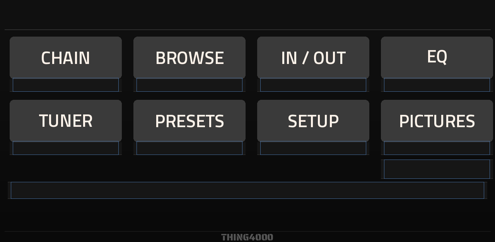
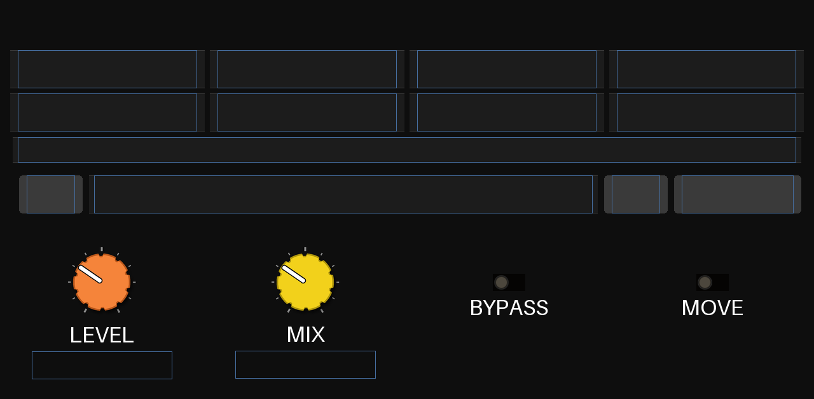
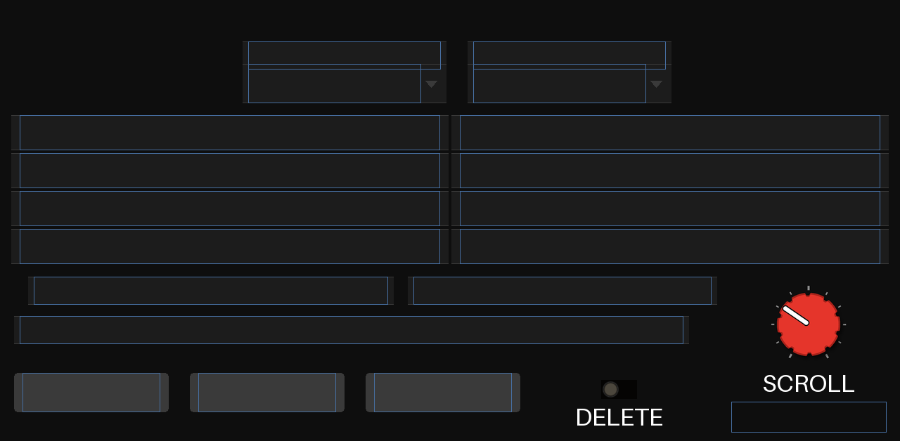

# THING4000 v0.1.1

**Neural Amp Modeler (NAM A2) amps and pedals plus IR cabs, as an effect plugin for MPC OS on the Akai Force. Download the captures you like on your PC, copy them to the Force, play.**

THING4000 runs [NeuralAmpModelerCore](https://github.com/sdatkinsonaudio/NeuralAmpModelerCore) (the NAM A2 engine) headless on the Force's
ARMv7, in an eight-block chain of NAM captures and IRs, with per-block level / mix / bypass / EQ, global EQ, gate, calibration and loudness
normalization. A Force screen lists the `.nam` captures and `.wav` IRs in the plugin's `tones` folder and loads the one you pick into the selected block.

> [!NOTE]
> **Status: 0.1.1, not yet tested on a Force.** It passes 39 offline checks on its ARM build under qemu (see `TESTING.md`). The CPU load of A2 captures on the
> Force is the thing only a real run can confirm.
>
> **No internet use.** The online library search, download and sign-in of 0.1.0 are switched off (compiled out): THING4000 never goes on the network.

## Use
Overview tiles: Chain, Browse, In / Out, EQ, Tuner, Presets, Setup. Select a block, load a capture from Browse, play. Reorder blocks with
MOVE. 48 factory chains and unlimited user presets. See `docs/GUIDE.md`.

 

## Needs
Akai Force or MPC with MPC OS Gen1 (ARMv7, glibc 2.31 or older). Captures and IRs you download yourself (for example from [tone3000.com](https://www.tone3000.com) on your PC) and copy into `THING4000/tones` on the Force.

## Credits and licence
Our code: [PolyForm Noncommercial 1.0.0](LICENSE): free to use, not for sale. Bundled third-party code belongs to its authors under their own licences
(`VENDORED.md`, `third_party/licenses/`): NeuralAmpModelerCore and nlohmann/json (MIT), Eigen (MPL 2.0), curl headers (curl licence).
The calibration and normalization rules follow the open-source TONE3000 plugin (MIT). THING4000 is not made by or connected to TONE3000. Captures you download keep their authors' terms.
Made by L'Cronx, Croydon, UK. Free; tips welcome at ko-fi.com/lcronx.
